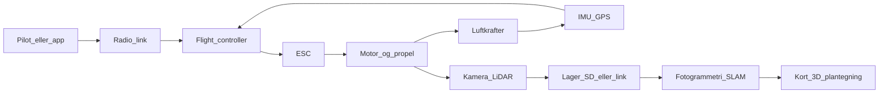

# 00 — Systemkort

Én sætning, før diagrammerne:

En quadcopter er en **underaktuert flyvende computer**. Fire motorer styrer fire akser — roll, pitch, yaw og thrust. Fremad og til siden får du ved at **vippe thrust-vektoren**, ikke ved at have en femte motor der peger den vej.

## To sløjfer, én maskine

Drone-systemet er to loops der kører samtidig:

1. **Flyvesløjfen** — hold maskinen i luften og derhen, hvor kommandoen peger.
2. **Datasløjfen** — optag, gem, bygg kort/3D/plantegning bagefter.

Hvis flyvesløjfen dør, falder maskinen. Hvis datasløjfen dør, lander du med en tur — og ingen leverance.

Læs pilene højt én gang: **kommando ind, kraft ud, sensor tilbage. Sensor sideløbende til data.**

## Flyvesløjfen i fem kasser

| Kasse | Gør | Typisk hardware |
|---|---|---|
| Kommando | Menneske eller autopilot siger “hvad” | RC, app, waypoint |
| Link | Kommandoen når maskinen | 2,4 GHz radio, LTE, intern bus |
| Hjerne | Regner motor-setpunkter | Flight controller |
| Muskler | Omdanner strøm til RPM | ESC + BLDC + propel |
| Sans | Måler om virkeligheden matcher | IMU, barometer, GPS, optisk flow |

Tilbagekoblingen er det, der gør det til et **kontrolsystem**, ikke en fjernstyret ventilator. Uden IMU ved controlleren ikke, at den allerede vælter.

## De fire kontrolvektorer

Alt, du drejer på en sender, lander i fire tal:

- **Thrust** — samlet løft. Op/ned.
- **Roll** — rotation om næse-hale-aksen. Vip venstre/højre.
- **Pitch** — rotation om vinge-aksen. Næse op/ned (frem/tilbage når du flyver).
- **Yaw** — rotation om den lodrette akse. Drej i luften.

Seks bevægelser i rummet (x, y, z, roll, pitch, yaw). Fire aktuatorer. Derfor **underaktuert**: translation i vandret plan er en *følge* af tilt, ikke en selvstændig motor.

Detaljerne står i [03-styring-og-kontrolvektorer.md](03-styring-og-kontrolvektorer.md).

## Datasløjfen i fire kasser

| Kasse | Gør | Eksempel |
|---|---|---|
| Sensor | Måler verden | RGB, termisk, LiDAR, multispektral |
| Lager | Overlever flyvningen | SD-kort, intern disk, downlink |
| Rekonstruktion | Gør billeder til geometri | Fotogrammetri, SLAM |
| Produkt | Noget et menneske kan bruge | Ortofoto, punkt sky, plantegning, rapport |

Udendørs RGB-drone giver **tag, facader, fodaftryk, højder** — ikke en indvendig plantegning. Indvendig plan kræver indendørs scan (SLAM, handheld eller indoor-drone). Se [05-data-og-plantegninger.md](05-data-og-plantegninger.md).

## Strøm vs. signal (første skelnen)

To ledningsnet, to jobs:

- **Strøm:** batteri → fordeler → ESC’er (motorer) og FC (hjerne). Tykke ledninger, høje ampere.
- **Signal:** radio/IMU ind i FC, små kommandoer ud til ESC (PWM eller DShot). Tynde ledninger, lav effekt.

Bland dem sammen i hovedet, og fejlfinding bliver gætværk. Schematics: [02-arkitektur-og-schematics.md](02-arkitektur-og-schematics.md).

## Hvor fysikken sidder

Software styrer **RPM-forskelle**. Fysikken styrer, hvad RPM *betyder*:

- Samlet thrust = vægt → hover.
- Overskud thrust → stigning.
- Forskel i thrust mellem motorer → moment → roll/pitch/yaw.
- Batteriets energitetthed sætter flyvetiden. Mere kode ændrer ikke joule i cellen.

Fysik: [01-fysik.md](01-fysik.md). Skala og last: [04-skalering-last-stoerrelser.md](04-skalering-last-stoerrelser.md).

## Hvad dette spor *ikke* er

- En byggevejledning til en flyvedygtig maskine.
- Et produktkatalog.
- Juridisk rådgivning. Lov-kort ligger i [06-loesninger-og-ai.md](06-loesninger-og-ai.md); kilden er Trafikstyrelsen.

## Næste trin

Læs [01-fysik.md](01-fysik.md). Stop når du kan sige: hover er thrust = vægt, og batteriet — ikke softwaren — er den hårde grænse.
