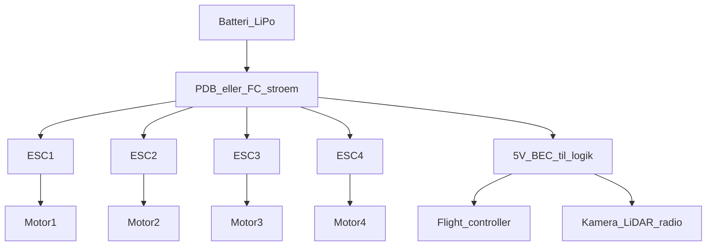
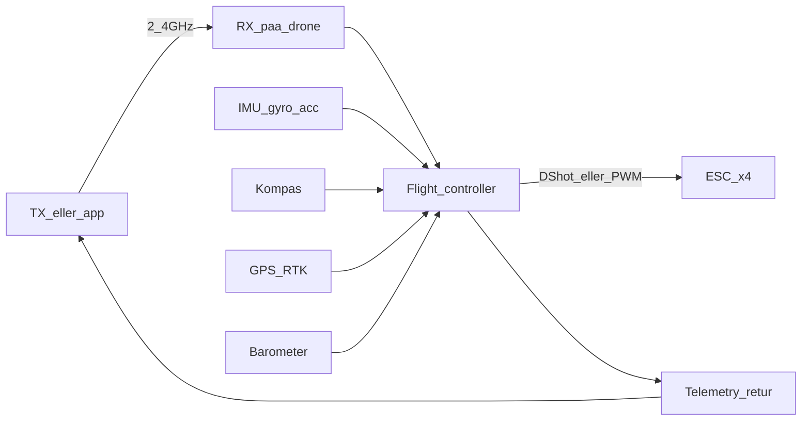

# 02 — Arkitektur og schematics

En quad er en ramme med **fire identiske kraftkæder**, én hjerne, ét batteri og én payload. Hvis du kan tegne det, kan du fejlsøge det.

## De fysiske blokke

- **Ramme** — holder motorer i et kendt geometrisk mønster (typisk X). Armen er moment-armen: længere arm = mere roll/pitch-moment pr. newton thrust, men mere flex og drag.
- **4× BLDC + propel** — børsteløs motor. Propelens stigning og diameter bestemmer, om du får løft eller fart.
- **ESC** (electronic speed controller) — én pr. motor. Tager jævnstrøm ind, laver trefaset veksel til motoren, lytter til kommando fra FC.
- **PDB / strømfordeling** — batteri splittes til ESC’er og til en 5 V/12 V-skinne til hjerne og kamera. På mange boards er PDB bygget ind i FC.
- **Batteri** — LiPo eller Li-ion. Spænding i “S” (3S = 3 celler i serie ≈ 11,1 V nominelt). Kapacitet i mAh. C-rating = hvor hårdt den tåler at blive tømt.
- **Flight controller (FC)** — computer + sensorer. Kører kontrolsløjferne.
- **IMU** — gyro (vinkelhastighed) + accelerometer. Sidder på FC. Uden den er der ingen stabilisering.
- **Barometer** — højde ud fra lufttryk. Drift i vejr og indoor.
- **Magnetometer** — kompas. Forstyrres af strømkabler og motorer; sidder ofte ude på en mast.
- **GPS / RTK** — position. RTK (Real Time Kinematic) giver centimeter til kortlægning, ikke til “sejt at hover”.
- **Radio** — modtager (RX) på dronen, sender (TX) i hånden eller app via Wi-Fi/OcuSync/LTE. Telemetri den anden vej: batteri, GPS, attitude.
- **Failsafe** — hvad der sker, når linket dør: hover, land, return-to-home. Det er en indstilling, ikke magi.
- **Payload** — gimbal + RGB, termisk, multispektral, LiDAR. Mekanisk og elektrisk last. Eget strømtræk.

## Plantegning 1: strøm

Tykke ledninger. Høje ampere. Fejl her = ild, brownout, motor cut.



Regler du kan bruge:

- Motorstrøm går **ikke** gennem FC’ens lille 5 V-skinne.
- Underspænding (brownout) slukker hjernen midt i luften. Kapacitorer på FC findes af den grund.
- Payload på samme BEC som FC kan støje eller suge spændingen ned. Tunge gimbals får ofte egen 12 V.

## Plantegning 2: signal

Tynde ledninger. Lav effekt. Fejl her = “den reagerer ikke”, ikke nødvendigvis røg.



Kommando ind: sticks eller waypoint. Tilstand ind: IMU først (hurtig), GPS senere (langsom, til position). Kommando ud: fire tal til fire ESC’er.

**PWM** er en pulsbredde (klassisk servo-signal). **DShot** er digital besked til ESC — mindre støj, bidirektionel RPM-feedback på mange setup. Du behøver ikke protokol-detaljerne for at forstå plantegningen: FC **siger** RPM, ESC **gør** RPM.

## X-layout (hvor motorerne sidder)

Set ovenfra, næse opad. Typisk “X”:

```
       næse
    M2 \   / M1
        \ /
        / \
    M3 /   \ M4
       hale
```

Konventioner varierer (hvilken motor er #1, hvilke spinner hvilken vej). Det, du skal huske:

- **Modsat rotation på naboer** — to CW, to CCW — så yaw-momenterne kan nulstilles i hover.
- Roll: mere thrust i venstre par, mindre i højre (eller omvendt).
- Pitch: mere bag, mindre for (næse ned = frem).
- Yaw: skru op på det ene rotationspar, ned på det andet. Reaktionsmoment drejer rammen den anden vej.

Mixer-matricen i firmware *er* denne geometri som tal. Forkert motor-rækkefølge i software = den vælter ved første stick. Det er konfiguration, ikke “hacking”.

## Hjerne: hvad FC faktisk kører

Tre lag (samme som i [03-styring-og-kontrolvektorer.md](03-styring-og-kontrolvektorer.md)):

1. **Rate** — “drej ikke hurtigere end jeg bad om” (gyro).
2. **Attitude** — “hold denne hældning” (gyro + acc, komplementær/AHRS).
3. **Position** — “bliv her / flyv dertil” (GPS, optisk flow, baro).

FC’en er en realtidscomputer. Loop på rate-niveau kører typisk hundredvis af gange i sekundet. ChatGPT kører ikke det loop.

## Linket er en del af maskinen

| Type | Bruges til | Begrænsning |
|---|---|---|
| 2,4 GHz RC (CRSF, ELRS, m.fl.) | Sticks, lav latency | Linje-of-sight, interferens |
| Producent-link (fx OcuSync) | Video + styring | Økosystem, afstand, frekvenslicens |
| Wi-Fi | Billige toys, app | Kort rækkevidde, optaget bånd |
| LTE / 5G | BVLOS-forsøg, docking | Sim, dækning, latency, regler |

Video og sticks kan køre på samme link eller to links. Telemetri er, så du ser satellitter og batteri *før* det er for sent.

Failsafe er arkitektur: **hvad er default, når pakkerne stopper.** RTH kræver GPS-fix og hjem-punkt. Indoor uden GPS: RTH er meningsløs — så land eller hover, afhængigt af setup.

## Payload som system, ikke tilbehør

Et kamera ændrer:

- **Masse og tyngdepunkt** — gimbal foran = anden pitch-trim.
- **Strøm** — 4K + gimbal kan være flere watt kontinuerligt.
- **Vibration** — dårlige dæmpere = slørede billeder og støj på IMU.
- **Datarate** — intern optagelse vs. nedsamplet downlink. Kortlægningskvalitet sidder på SD’en, ikke på telefon-preview.

LiDAR er en egen computer + scanner + GPS-tid. Den vejer, suger strøm og kræver kalibrering mod IMU. Derfor bor LiDAR på 5–15 kg-klassen, ikke på 249 g-legetøj. Se [04-skalering-last-stoerrelser.md](04-skalering-last-stoerrelser.md).

## Hvad disse schematics *ikke* er

- Printplade-layout eller loddevejledning.
- Firmware-udnyttelse, spektrum-jamming, geofence-omgåelse.
- En stykliste du kan bestille og flyve i morgen.

De er **kort over ansvar**: strøm bærer newton, signal bærer beslutninger.

## Næste trin

Læs [03-styring-og-kontrolvektorer.md](03-styring-og-kontrolvektorer.md). Stop når du kan nævne de 4 vektorer og forklare, hvorfor fremad kræver tilt.
