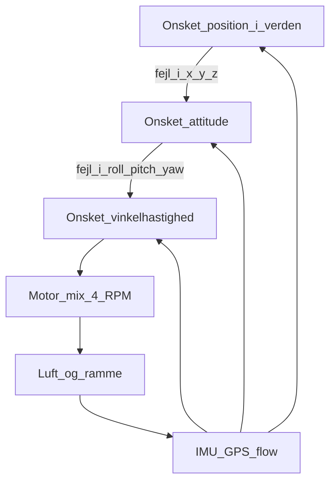

# 03 — Styring og kontrolvektorer

Sticks, app og waypoints taler alle det samme sprog: **fire tal**. Forskellen er kun, hvem der udfylder tallene.

## To koordinatsystemer

**Legeme-akse** (body): fast på dronen.

- x: frem (næse)
- y: højre
- z: ned (mange autopilots) eller op (nogle visualiseringer). Vær konsekvent.

**Jord-akse** (ofte NED: North, East, Down): fast på verden. GPS og “fly 50 m nord” lever her.

IMU måler i body. Du vil styre i verden. FC roterer vektorer mellem de to med attitude-estimatet (hvor meget er jeg already vippet). Dårlig attitude = den “korrigerer” den forkerte vej.

## De fire kontrolvektorer

Alt input lander her:

| Vektor | Hvad der ændres | Motor-mix (idé) |
|---|---|---|
| **Thrust** | Sum af alle fire RPM | Alle fire op eller ned |
| **Roll** | Moment om x (næse-akse) | Venstre par vs. højre par |
| **Pitch** | Moment om y | Forreste par vs. bagerste par |
| **Yaw** | Moment om z | CW-par vs. CCW-par |

Fire aktuatorer, fire primære kommandoer. Det går op. Det, der **ikke** går op uden trick, er ren translation i x og y: der er ingen motor der peger frem.

## Hvorfor du vipper for at køre frem (underaktuert)

Seks frihedsgrader: tre positioner + tre vinkler. Fire motorer. Underaktuert.

Løsningen: **thrust er en vektor.** I hover peger den lodret. Pitcher du næsen ned, får vektoren en fremad-komponent. Du accelererer frem. Den lodrette komponent falder — derfor throttle op, ellers taber du højde.



Yderste sløjfe: position. Midterste: attitude. Inderste: rate. Inderst kører hurtigst.

## Nested loops, tre tempoer

**1. Rate-PID (inderst)**  
Gyro siger: jeg yaw’er 20 °/s. Setpunkt: 0 eller stick. Output: moment-kommando. Uden denne sløjfe er en quad ukontrollabel for et menneske — den er dynamisk ustabil.

**2. Attitude (mellem)**  
Accelerometer + gyro (+ kompas) siger: jeg hælder 8° roll. Setpunkt: 0 i “angle mode”, eller stick i “stabilized”. Output: et rate-setpunkt. Det er her “den retter sig op”, når du slipper stick.

**3. Position (yderst)**  
GPS / optisk flow / visuel odometri: jeg har drevet 2 m øst. Output: et attitude-setpunkt (vip lidt vest) plus thrust til højde. Det er GPS-hold, waypoint og RTH.

Hvis GPS glitcher, skal yderste sløjfe **ikke** styre. Derfor modes: Acro (kun rate), Angle (attitude), Loiter/Hold (position).

## PID uden religion

En PID er tre tal på en fejl:

- **P** — træk nu, proportionalt med fejlen.
- **I** — træk for den fejl, der har ligget længe (vind, tyngdepunkt).
- **D** — dæmp, hvis fejlen ændrer sig hurtigt (modvirk overshoot).

For højt P: oscillation. For højt I: den “kæmper” efter du er i mål. For højt D: den reagerer på IMU-støj. Tuning er håndværk på den konkrete ramme. Du skal forstå *hvad* der oscillerer (typisk rate-P), ikke memorere andres tal.

## RC-sticks vs. app vs. autonomi

Samme fire vektorer, forskellig kilde:

| Kilde | Typisk mapping | Latency | Brug |
|---|---|---|---|
| Mode 2-sender | Venstre stick: thrust + yaw. Højre: roll + pitch | Lav | Sport, cine, backup |
| App-sticks | Samme, på glas | Højere, Wi-Fi/OcuSync | Forbrugerfoto |
| Waypoints | Position-setpunkter; FC fylder vektorerne | Planlagt | Kortlægning, linjeflyvning |
| Tracking/follow | Computer vision sætter position-fejl | Variabel | Film, sport — stadig de fire tal ud |

**Antagelse:** “AI flyver dronen” i forbrugerprodukter betyder oftest *ydre sløjfe* (følg objekt, undgå træ). Rate-loop er stadig klassisk firmware. Du prompt’er ikke motor 3 fra et chatvindue. Se [06-loesninger-og-ai.md](06-loesninger-og-ai.md).

## Mixer: fra vektorer til fire RPM

Grov, ikke en firmware-kopi:

```
M1 = thrust + roll + pitch - yaw
M2 = thrust - roll + pitch + yaw
M3 = thrust - roll - pitch - yaw
M4 = thrust + roll - pitch + yaw
```

Tegnene afhænger af motor-nummer og spin-retning. Pointen: **ét sæt vektorer, fire summer**. Saturation (en motor max, en anden min) betyder, at du har bedt om mere moment, end geometrien + batteriet kan levere. Så klipper den — typisk yaw først, fordi yaw er “billigst” at ofre. Det føles som at den ikke drejer, når du allerede ligger hårdt i pitch.

## Optisk flow og indoor

Uden GPS (indendørs, under tag, by-canyon):

- **Optisk flow-kamera** + afstandssensor: estimér vandret fart over gulv/jord.
- **SLAM** (kamera eller LiDAR): bygg et kort, hold pose.
- Barometer lyver i rum med HVAC. Ultralyd/ToF til loft/gulv er ærligere tæt på flader.

Position-loop’en er den samme. Sensoren, der fodrer den, er en anden. Mikro-droner i gram-klassen har knap plads til RTK; de lever på IMU + kamera og kort rækkevidde. Se [04-skalering-last-stoerrelser.md](04-skalering-last-stoerrelser.md).

## Hvad du skal kunne sige højt

1. Fire vektorer: thrust, roll, pitch, yaw.
2. Fremad = pitch (tilt thrust) + mere throttle.
3. Tre loops: rate → attitude → position. Inderst er gyro.
4. App, RC og waypoint er forskellige *sendere* til samme vektorer.
5. Mixer er geometri plus fortegn — ikke magi.

## Næste trin

Læs [04-skalering-last-stoerrelser.md](04-skalering-last-stoerrelser.md). Stop når du kan placere “bi-kamera”, “arbejdsdrone” og “LiDAR-survey” på størrelsesstigen og sige, hvad der knækker først: last, tid eller lov.
