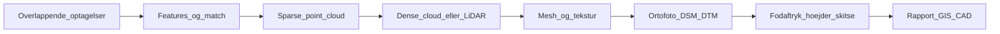

# 05 — Data og plantegninger

Flyvningen er indsamling. Værdien sidder i **geometri og produkter**, som et menneske kan bruge uden at have været i luften.

To betydninger af “plantegning” i dette spor:

1. Drone-schematics — [02-arkitektur-og-schematics.md](02-arkitektur-og-schematics.md).
2. **Bygnings- og terrænplaner** fra sensor-data — denne fil.

## Sensorer (hvad der faktisk måles)

| Sensor | Måler | God til | Dårlig til |
|---|---|---|---|
| RGB-kamera | Farve, tekstur, vinkler | Fotogrammetri, visuel inspektion | Gennem vegetation, nat |
| Termisk | Relativ temperatur | Taglæk, solceller, el | Absolutte °C uden kalibrering |
| Multispektral | Bånd til vegetation | NDVI, afgrøde-stress | Arkitektur-plantegning |
| LiDAR | Afstand + intensitet, mange punkter | Terræn under løv, præcis Z | Billig lille drone, våde flader |
| RTK/PPK GPS | Kamera-/scanner-pose i cm | Skala og georef | Indoor, under tag |

RGB alene *kan* bygge 3D, hvis overlap og geometri er i orden. LiDAR *måler* afstand direkte. De er ikke det samme workflow.

## Kæden: capture → geometri → produkt

**Fotogrammetri (RGB):**

1. Flyv et **mønster** med overlap (typisk 70–80 % front, 60–70 % side — justér efter software og højde).
2. Find fælles punkter mellem billeder (features).
3. Genskab kamera-poses og en tynd sky (sparse).
4. Fortæt til dense cloud, evt. mesh.
5. Projekt ned til **ortofoto** (kort uden perspektiv) og **DSM** (overfladehøjde) / **DTM** (terræn, hvis du filtrerer bygninger/træer).

**LiDAR:** skip feature-match. Du får en sky med det samme, plus IMU/GPS-trajektorie. Vegetation: flere retur-ekkoer kan nå jord.

Uden overlap eller med kun 10 hero-billeder fra samme vinkel: **ingen** reconstruering. Det er foto, ikke et kort.

## Udendørs plantegning vs. indvendig plan

**Udendørs drone (typisk RGB over hus/grund):**

- Tagflade, skorsten, ovenlys
- Bygnings**fodaftryk** (omrids)
- Højder, facader, volumen af bunke/jord
- Ikke: vægge inde i stuen, dørhul, køkkenø

Det, du kan levere som “plantegning”, er ofte:

- tagplan / roof outline
- site plan (bygning på grunden, kørevej, træer)
- facader som ortofoto
- mål på udvendige længder, hvis georef er i orden

**Indvendig plantegning** kræver **indendørs scan**: handheld LiDAR, Matterport-agtig kamera-rig, indoor-drone med SLAM, eller totaltation. GPS virker dårligt inde. SLAM bygger kortet, mens du går/flyver. Blanding: drone ude + scan inde, samlet i ét koordinatsystem med ground control.

Antagelse: kunder siger “plantegning” og mener Plantegning.dk-agtig boligplan. Sig nej, hvis du kun har en overflyvning. Tilbyd **tag- og situationsplan**, eller book en indoor-scan.

## Mini-SOP: ét hus, RGB, udendørs

Mål: ortofoto + tagflade-skitse. Ikke indvendig plan.

1. **Tilladelse og luft:** Open-kategori, afstand til folk, vejr. Se [06-loesninger-og-ai.md](06-loesninger-og-ai.md). Flyv kun lovligt.
2. **Plan:** gitter over hus + 20–30° obliques på facader. Højde så GSD (cm/pixel) matcher behov — taginspektion tåler ikke 8 cm/pixel.
3. **RTK eller GCP:** mindst ét af delene, hvis mål skal kunne bruges i CAD. Uden: pæn 3D, løs skala.
4. **Capture:** ~60–120 billeder for et parcelhus er et fornuftigt interval. Skarpe, overlap, ikke kun hover-spin.
5. **Process:** WebODM, Metashape, RealityCapture eller tilsvarende. Tjek at sparse cloud ligner huset, før du kører dense natten lang.
6. **Produkt:** ortofoto (GeoTIFF), DSM, eventuelt billed-mesh. I QGIS/CAD: spor tagkant, mål længder, eksport PDF-skitse.
7. **QA:** sammenlign 2–3 mål med laser/målebånd på jorden. Hvis det afviger mere end aftalen, er det ikke en plantegning — det er et billede.

## Andre formål, samme kæde

| Formål | Extra i kæden | Leverance |
|---|---|---|
| Taginspektion | Obliques + evt. termisk | Annoterede billeder, skadesliste |
| Byggeplads | Gentagne flyvninger, samme grid | Volumen, cut/fill, tidsmaskine |
| Landbrug | Multispektral, kalibreringsplade | NDVI-kort, zoner |
| Ændring | To epoker, alignment | Diff-kort, “nyt tagvindue her” |
| 3D til kunde | Mesh + tekstur, let decimering | Web-viewer, ikke rå 80 GB sky |
| GIS | Georef, metadata, koordinatsystem | Lag i QGIS, ikke et MP4 |

AI hører til **efter** geometrien (klassificer tagsten, find solcelle, skriv rapport) — eller som hjælp til feature/match. Den erstatter ikke overlap. Se [06-loesninger-og-ai.md](06-loesninger-og-ai.md).

## Værktøj på konceptniveau

- **WebODM / OpenDroneMap** — åben fotogrammetri.
- **Metashape / RealityCapture** — kommerciel, ofte hurtigere/tættere på produktion.
- **CloudCompare** — kig på skyer, mål, clip, align.
- **QGIS** — kort, ortofoto, spor fodaftryk, print.
- **CAD** — hvis kunden skal bruge DWG, ikke et screenshot.

Du behøver ikke eje dem alle. Du skal vide, **hvilket trin** de dækker i kæden.

## Fejl der ødelægger plantegningen

- For lidt overlap, kun facader uden tag, eller kun tag uden facader
- Bevægelsessløring, auto-eksponering der “pumper” mellem billeder
- Reflekterende glas, vand, ensartet grus — få features
- Ingen skala (ingen RTK/GCP/målestok)
- Indoor-forventning til outdoor-data

## Hvad du skal kunne sige højt

1. Overlap → match → sky → mesh/ortofoto. Uden overlap: foto, ikke kort.
2. Udendørs drone: tag, fodaftryk, højder. Ikke stue-plantegning.
3. Indvendig plan = SLAM/indoor-scan.
4. Mål kræver RTK eller GCP plus en jord-check.
5. Produktet er GeoTIFF/CAD/rapport — ikke drone-videoen.

## Næste trin

Læs [06-loesninger-og-ai.md](06-loesninger-og-ai.md). Stop når du kan skille **flyvning**, **dataarbejde** og **AI** ad, og ved at Trafikstyrelsen er kilden til regler — ikke denne fil.
